**简体中文** | [English](README_EN.md)

<div align="center">
  
  <h1>七日杀自定义背包容量工具</h1>
  <p>自定义背包容量与布局，提前预览，然后一键生成并安装自己的背包模组。</p>
  <p><strong>v1.4.1</strong> · Windows 64 位 · 适配《七日杀》V3.3 及以上版本</p>
  <p><a href="https://github.com/WangCAC/7-Days-Backpack-Tools/releases/latest">下载最新版</a> · <a href="CHANGELOG.md">更新日志</a> · <a href="#安装与使用">安装与使用</a> · <a href="https://github.com/WangCAC/7-Days-Backpack-Tools/issues">反馈问题</a></p>
</div>

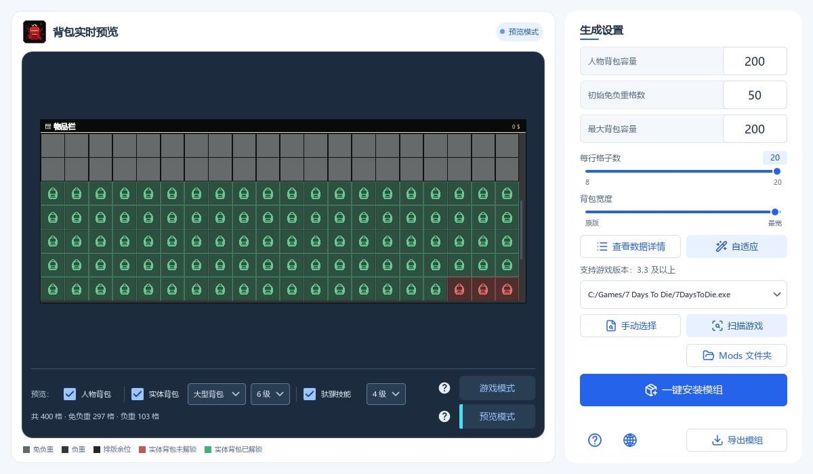

*上图为示例配置：人物背包 200 格、初始免负重 50 格、最大实体背包额外增加 200 格。可以按自己的玩法调整。*

## v1.4.1 更新亮点

- 改善自定义宽度后的制作队列对齐，修正部分格子挤到背包区域的问题。
- “自适应”升级为修整当前布局，提供正常、强力、维持高度三种方式。
- 预览滚动条始终可见；选项说明固定显示，改善鼠标悬停时的闪动。

[查看完整更新日志](CHANGELOG.md)

## 主要功能

- **自由设置容量**：分别调整人物背包容量、初始免负重格数与最大实体背包容量；小型、中型和其他品质背包会一起调整。
- **自定义布局**：每行选择 8～20 格，宽度从原版调整到最宽，再用“自适应”修整边缘与底部空白。
- **实时预览**：选择背包类型、品质与驮骡等级，提前查看免负重与负重区域；支持游戏模式和带标记的预览模式。
- **数据详情**：集中比较各级驮骡加成，以及各类背包不同品质增加的格数。
- **便捷安装与分享**：查找游戏后直接安装，也可以导出 ZIP；换配置时可清理本工具生成的其他模组。
- **中英文界面**：支持语言切换，按钮配有功能图标；大容量死亡掉落背包也支持滚动查看物品。

## 安装与使用

### 1. 下载并打开工具

从 [最新 Release](https://github.com/WangCAC/7-Days-Backpack-Tools/releases/latest) 下载：

| 文件 | 使用方式 |
| --- | --- |
| ZIP 便携版 | 完整解压后，运行文件夹中的 `7DaysBackpackTools.exe`。 |
| 单文件 EXE | 直接运行下载的 EXE。 |

安装或更换生成的模组前，先关闭游戏。升级工具后，请重新安装或导出配置，让背包模组也应用本次改进。

**默认配置：**人物背包 48 格、初始免负重 32 格、最大实体背包额外增加 48 格，每行 8 格，使用原版宽度。

### 2. 设置容量并预览

填写右侧三个容量数值。初始免负重格数不能超过人物背包容量；**最大背包容量**指大型 6 级实体背包**额外提供**的格数，与人物背包容量分开设置。

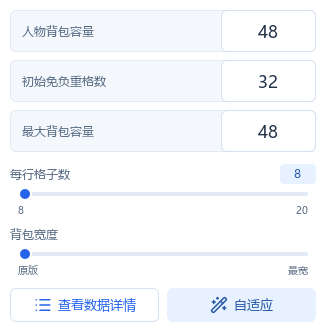

在左下方勾选实体背包、驮骡技能，并选择背包类型、品质和技能等级。勾选项用于预览，游戏里的装备和技能仍由角色实际情况决定。

| 预览模式：清楚标记实体背包增加的容量 | 游戏模式：模拟游戏中实际看到的效果 |
| --- | --- |
| 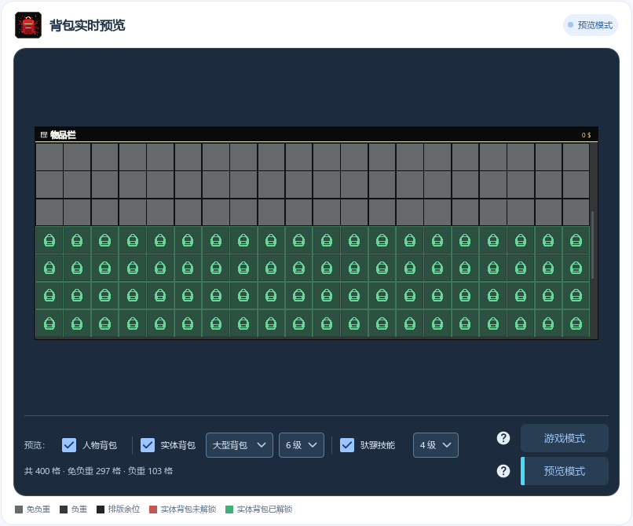 | 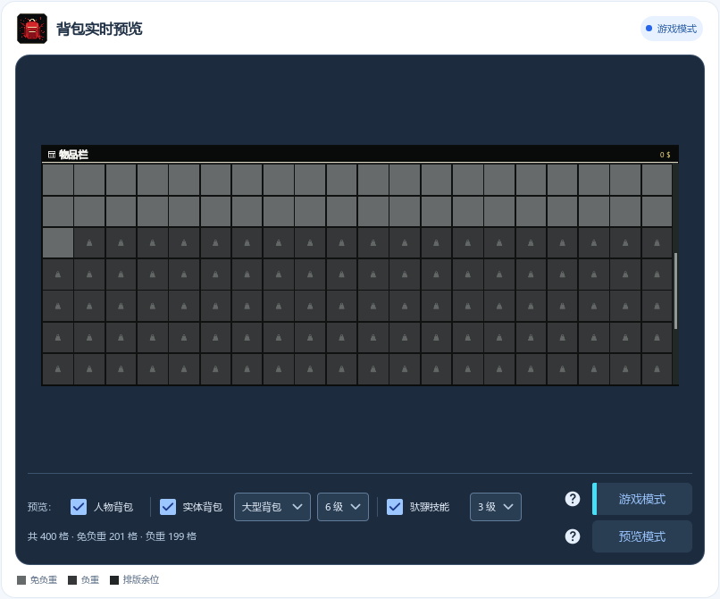 |

点击**查看数据详情**可以比较各等级增加的格数。

<details>
<summary>查看容量与技能详情截图</summary>

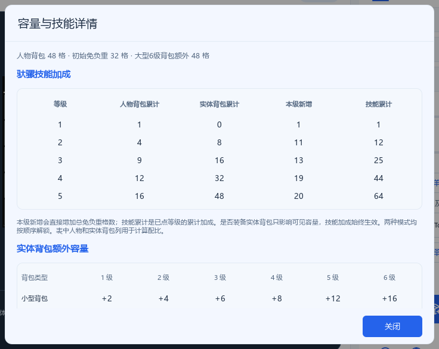

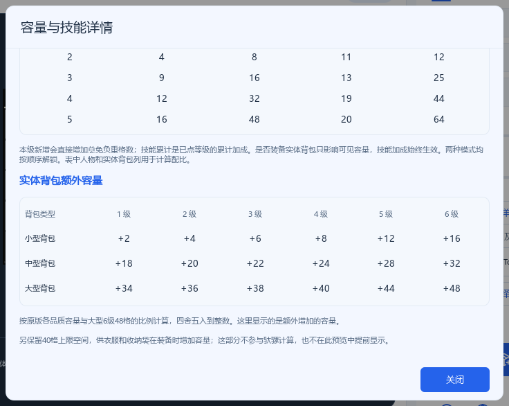

</details>

### 3. 调整布局与边缘

拖动**每行格子数**与**背包宽度**滑动条，观察左侧预览。以下示例都为每行 16 格，只改变宽度：

| 原版宽度 | 最宽 |
| --- | --- |
| 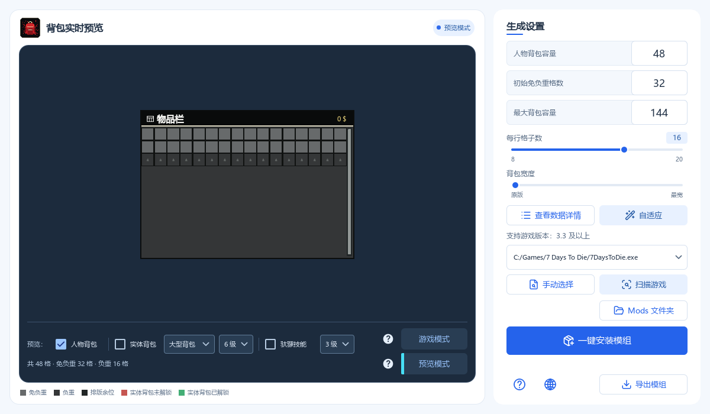 | 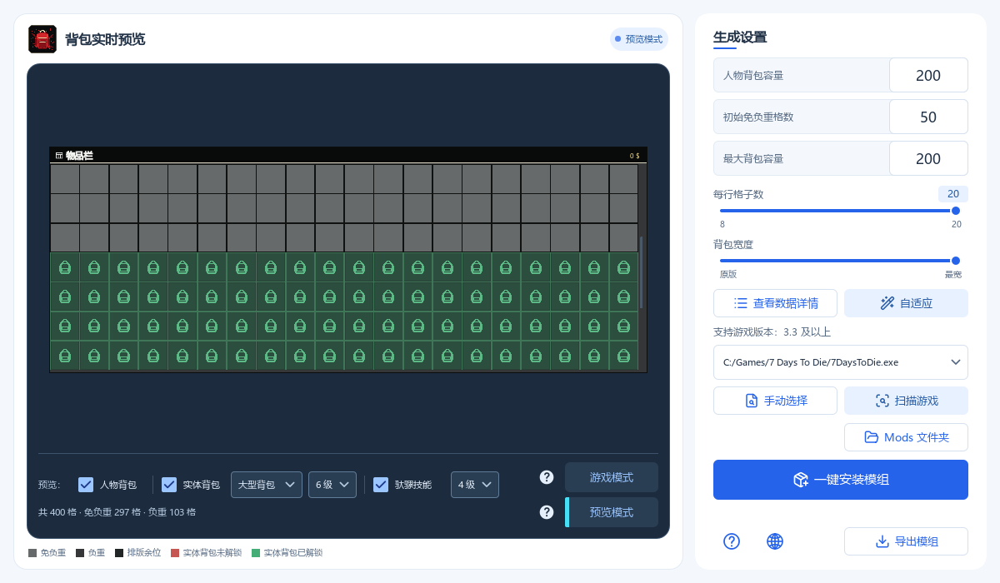 |

选好希望预览的背包状态与布局后，点击**自适应**，选择一种方式并点击**确定**：

| 方式 | 效果 |
| --- | --- |
| 优化背包边缘（正常） | 修整右侧与底部边缘，保留完整行的空白。 |
| 优化背包边缘（强力） | 进一步收掉当前预览格子之外的多余空白行，让背包更紧凑。 |
| 维持当前背包高度 | 保持整体高度，只修整右侧边缘。 |

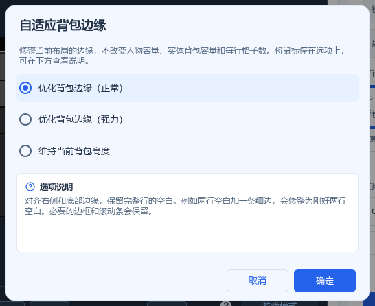

鼠标停在选项上即可查看说明。宽度滑动条和预览会同步更新，安装和导出的模组也会使用调整结果。必要的边框与滚动条会保留。

<details>
<summary>查看强力模式调整前后的对比</summary>

示例为人物 48 格、初始免负重 32 格、最大实体背包 144 格、每行 16 格，未勾选实体背包预览。

| 调整前 | 强力模式调整后 |
| --- | --- |
| 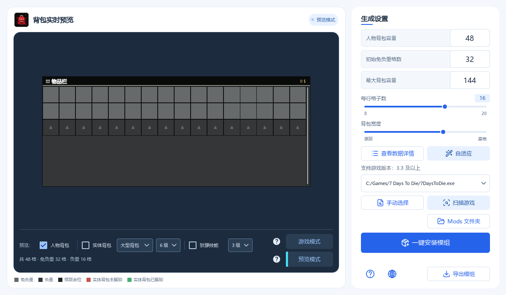 | 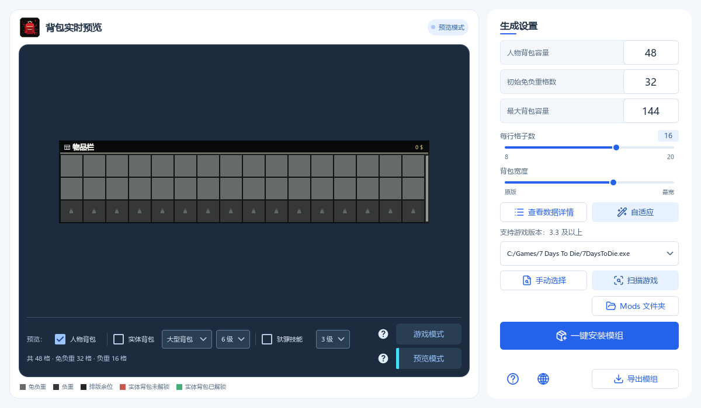 |

</details>

强力模式按当前预览的格数收紧窗口，之后装备背包增加的格子仍可通过滚动查看。之后如果又调整每行格子数或宽度，可以再次点击自适应修整新的布局。

### 4. 选择游戏并安装

点击**扫描游戏**。如果未找到，点击**手动选择**，选中游戏目录中的 `7DaysToDie.exe`。有多个路径时，可以从下拉列表选择。


点击**一键安装模组**，工具会将模组放进所选游戏的 `Mods` 文件夹，文件夹不存在时自动创建。

在安装结果弹窗中，默认勾选**删除本软件产生的其他模组，以防冲突**。点击**确定**后，会清理本工具生成的其他配置，并保留本次安装的模组；需要保留旧配置时，可以取消勾选。

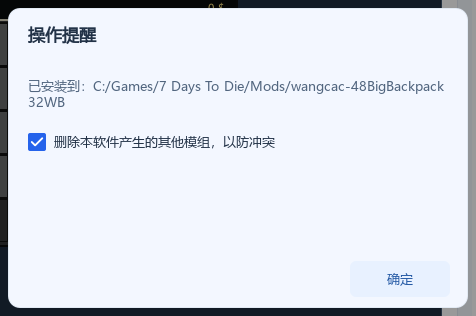

点击 **Mods 文件夹**可以查看安装位置，然后启动游戏使用新的配置。

### 5. 导出与分享

点击**导出模组**保存 ZIP。手动安装或分享时，将其中的整个模组文件夹解压到游戏的 `Mods` 文件夹，保留里面的 `ModInfo.xml` 与 `Config`。

以后想换配置，关闭游戏，重新调整并安装或导出，再启动游戏即可。仅修改工具中的预览，不会更新已经安装的模组。

## 从源码构建

<details>
<summary>C++ / Qt 开发与构建说明</summary>

需要 Qt 6.8 或更新版本，以及与 Qt 套件匹配的 C++ 编译器。可以用 Qt Creator 打开 `CMakeLists.txt`，选择桌面 Qt 套件并构建 Release，或执行：

```bash
cmake -S . -B build -DCMAKE_BUILD_TYPE=Release -DCMAKE_PREFIX_PATH=<Qt安装目录>
cmake --build build --config Release
```

直接构建得到的程序需要随附 Qt 运行库，Windows 分发时可以用 Qt 的 `windeployqt` 收集依赖。`packaging/Launcher.cpp` 是发布单文件 EXE 使用的原生启动器源码；发布打包时生成运行文件清单与资源，不参与上述主程序构建。

`ui/preview` 保留界面预览与验证源码，可以单独用 CMake 构建。

</details>

## 反馈与许可

发现问题时，请在 [Issues](https://github.com/WangCAC/7-Days-Backpack-Tools/issues) 附上工具版本、游戏版本、容量与布局设置，以及问题截图。欢迎提交 Pull Request。

由 [WangCAC](https://github.com/WangCAC) 开发，采用 [MIT 许可证](LICENSE)。按钮图标来自 [Lucide](https://lucide.dev/)，见 [图标许可证](assets/lucide-LICENSE.txt)。
