[简体中文](README.md) | **English**

<div align="center">
  
  <h1>7 Days to Die Custom Backpack Capacity Tool</h1>
  <p>Customize backpack capacity and layout, preview the result, then generate and install your own backpack mod.</p>
  <p><strong>v1.4.1</strong> · Windows 64-bit · Supports 7 Days to Die V3.3 and later</p>
  <p><a href="https://github.com/WangCAC/7-Days-Backpack-Tools/releases/latest">Download</a> · <a href="CHANGELOG_EN.md">Changelog</a> · <a href="#installation-and-use">Installation and Use</a> · <a href="https://github.com/WangCAC/7-Days-Backpack-Tools/issues">Report an Issue</a></p>
</div>

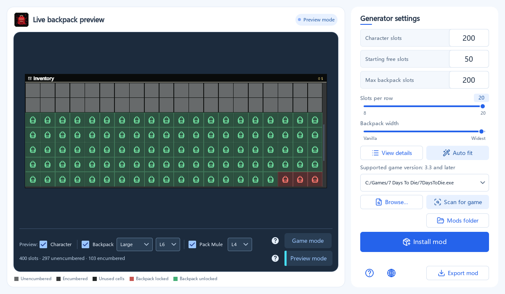

*This example uses 200 character slots, 50 starting unencumbered slots, and up to 200 additional equipped backpack slots. Adjust the values to suit your playstyle.*

## v1.4.1 Highlights

- Improved crafting queue alignment after changing backpack width, fixing slots that intruded into the backpack area.
- Auto fit now refines your current layout, with normal, strong, and keep-height options.
- The preview scrollbar stays visible. Option details appear in a fixed area, with steadier hover highlighting.

[Read the full changelog](CHANGELOG_EN.md)

## Main Features

- **Flexible capacity:** Set character slots, starting unencumbered slots, and maximum equipped backpack capacity. Small, medium, and other quality levels adjust together.
- **Custom layout:** Choose 8–20 slots per row and a width from vanilla to widest, then use Auto fit to refine edges and bottom space.
- **Live preview:** Choose a backpack type, quality, and Pack Mule rank to see unencumbered and encumbered areas. Switch between Game mode and marked Preview mode.
- **Capacity details:** Compare Pack Mule bonuses and additional slots for each backpack type and quality.
- **Install and share:** Find the game and install directly, or export a ZIP. Remove older configurations generated by this tool when installing a new one.
- **Bilingual interface:** Switch between Chinese and English, with function icons on buttons. Large death backpacks also support scrolling through dropped items.

## Installation and Use

### 1. Download and Open the Tool

Download from the [latest release](https://github.com/WangCAC/7-Days-Backpack-Tools/releases/latest):

| File | How to use it |
| --- | --- |
| Portable ZIP | Extract the entire folder, then run `7DaysBackpackTools.exe` inside it. |
| Single-file EXE | Run the downloaded EXE directly. |

Close the game before installing or replacing a generated mod. After upgrading the tool, install or export your configuration again so the generated backpack mod also receives these improvements.

**Defaults:** 48 character slots, 32 starting unencumbered slots, up to 48 additional equipped backpack slots, 8 slots per row, and vanilla width.

### 2. Set Capacity and Preview

Enter the three capacity values on the right. Starting free slots cannot exceed Character slots. **Max backpack slots** means the **additional slots** provided by a large quality-6 equipped backpack, separate from Character slots.

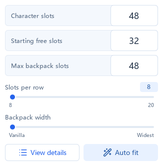

Enable Backpack and Pack Mule at the bottom left, then choose a backpack type, quality, and skill rank. These choices control the preview; your character's actual equipment and skills determine their effects in the game.

| Preview mode: marks the extra capacity from an equipped backpack | Game mode: simulates the in-game appearance |
| --- | --- |
| 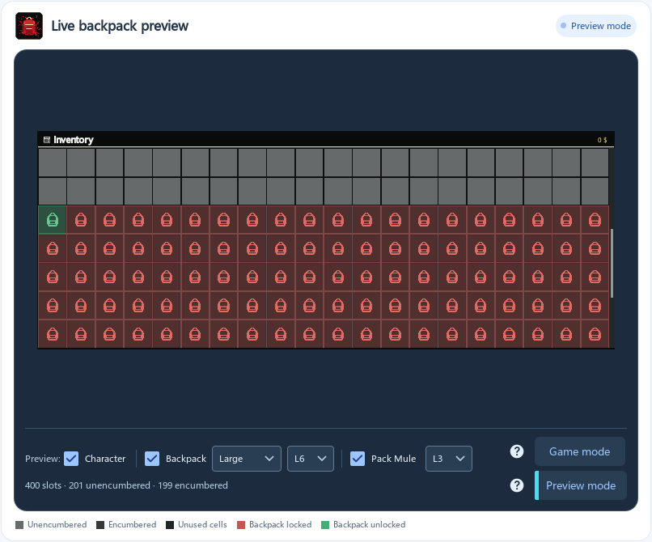 | 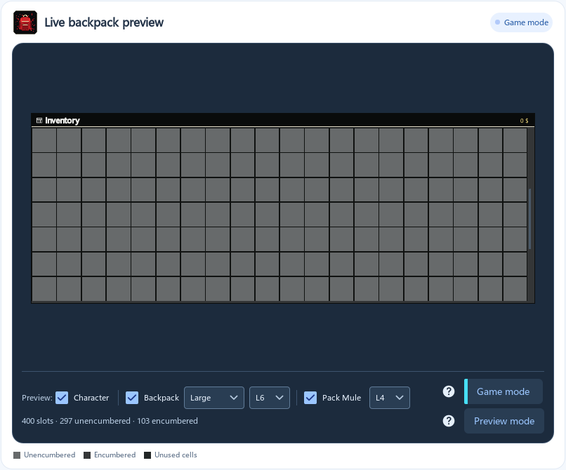 |

Click **View details** to compare the additional slots at each level.

<details>
<summary>See capacity and skill screenshots</summary>

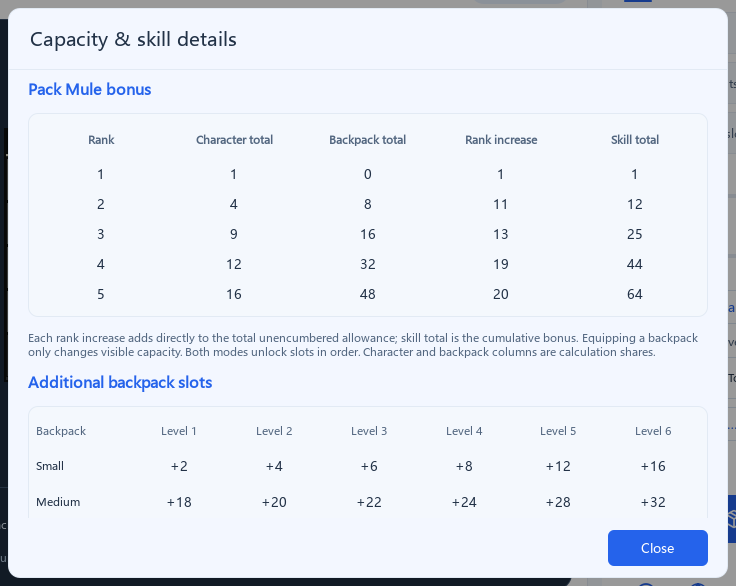

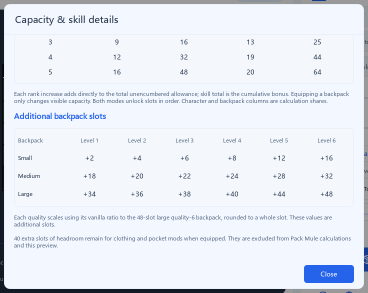

</details>

### 3. Adjust Layout and Edges

Move the **Slots per row** and **Backpack width** sliders and check the preview. Both examples below use 16 slots per row; only the width changes:

| Vanilla width | Widest |
| --- | --- |
| 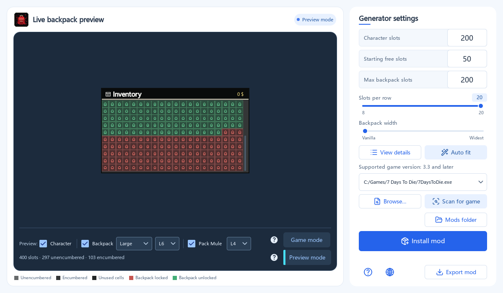 | 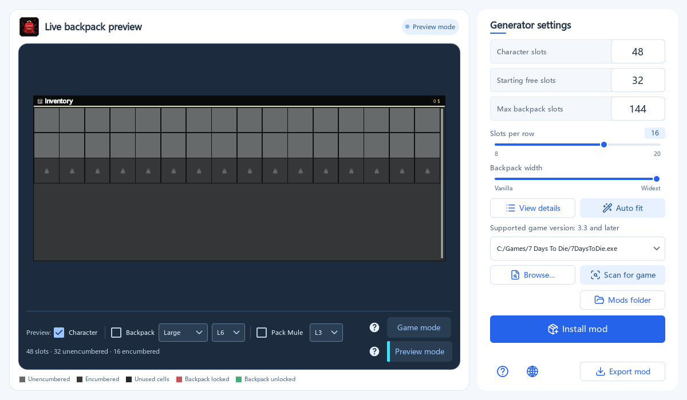 |

Choose the equipment state and layout you want to preview. Click **Auto fit**, select an option, and click **OK**:

| Option | Effect |
| --- | --- |
| Optimize backpack edges (normal) | Fits the right and bottom edges while retaining complete blank rows. |
| Optimize backpack edges (strong) | Also removes extra blank rows beyond the slots in the current preview for a more compact backpack. |
| Keep current backpack height | Preserves the overall height and fits only the right edge. |

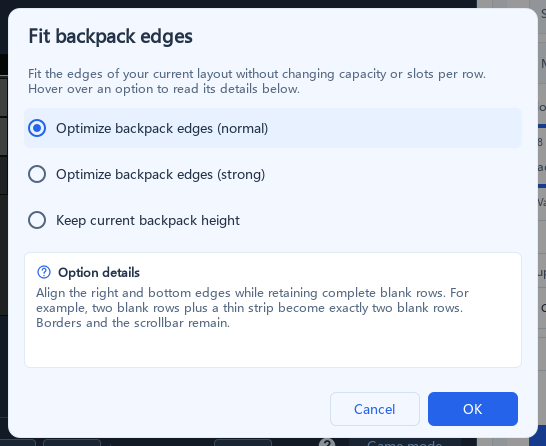

Hover over an option to read its details. The width slider and preview update together, and installed and exported mods use the fitted layout. Necessary borders and the scrollbar remain.

<details>
<summary>Compare the layout before and after strong fitting</summary>

This example uses 48 Character slots, 32 Starting free slots, 144 Max backpack slots, and 16 slots per row. Backpack preview is disabled.

| Before fitting | After strong fitting |
| --- | --- |
| 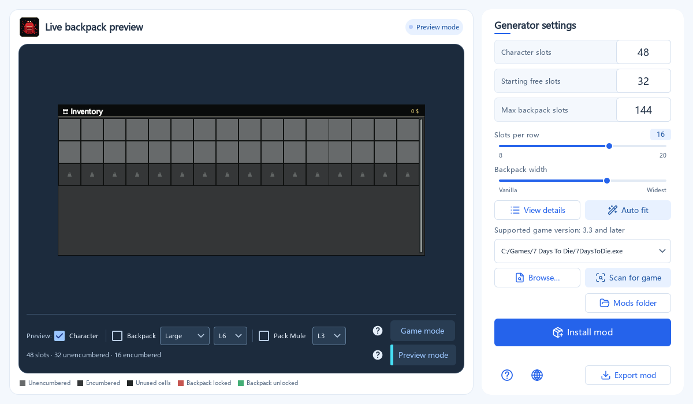 | 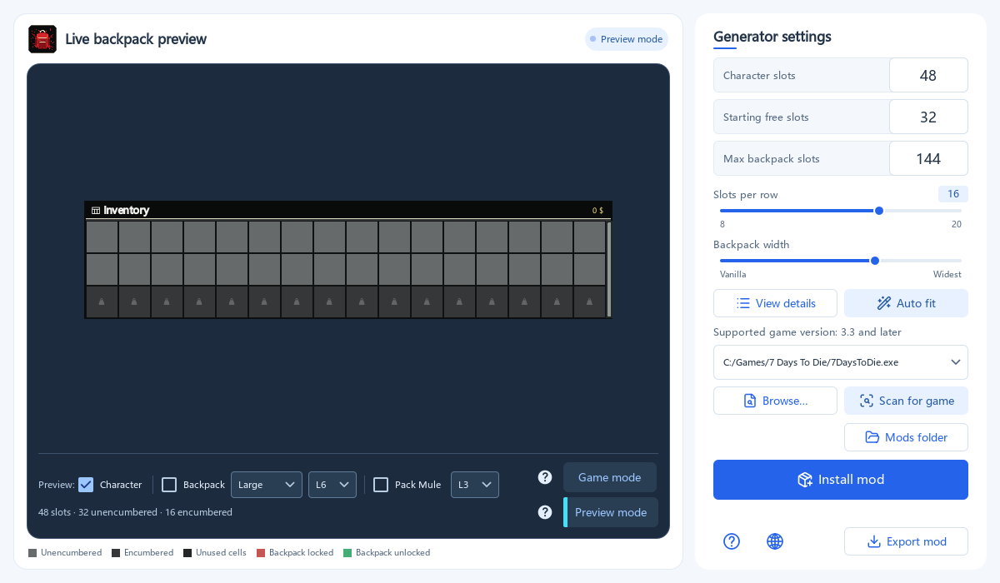 |

</details>

Strong mode fits the window to the slots currently shown in the preview. Extra slots from a backpack equipped later remain accessible by scrolling. If you later change slots per row or width, run Auto fit again to refine the new layout.

### 4. Select the Game and Install

Click **Scan for game**. If the game is not found, click **Browse…** and select `7DaysToDie.exe` in the game directory. Choose from the drop-down list if multiple paths are available.

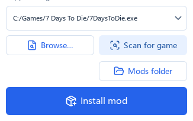

Click **Install mod**. The tool places the mod in the selected game's `Mods` folder, creating it if needed.

The installation result dialog has **Delete other mods generated by this tool to prevent conflicts** checked by default. Click **OK** to remove other configurations generated by this tool and keep the newly installed mod. Uncheck it to keep older configurations.

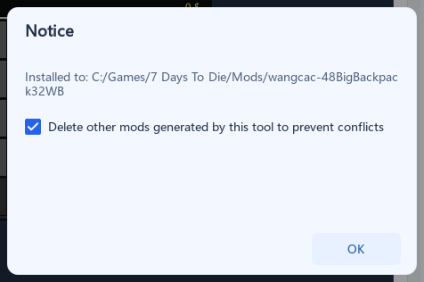

Click **Mods folder** to open the installation location, then start the game to use the new setup.

### 5. Export and Share

Click **Export mod** to save a ZIP. For manual installation or sharing, extract the entire mod folder from the ZIP into the game's `Mods` folder. Keep `ModInfo.xml` and `Config` inside it.

To change your setup later, close the game, adjust the settings, install or export the new configuration, and start the game again. Changing the preview alone does not update an already installed mod.

## Building from Source

<details>
<summary>C++ / Qt development and build instructions</summary>

Use Qt 6.8 or later and a C++ compiler compatible with your Qt kit. Open `CMakeLists.txt` in Qt Creator, select a desktop Qt kit, and build Release, or run:

```bash
cmake -S . -B build -DCMAKE_BUILD_TYPE=Release -DCMAKE_PREFIX_PATH=<Qt-installation-directory>
cmake --build build --config Release
```

The built executable requires Qt runtime libraries. On Windows, use Qt's `windeployqt` to collect dependencies for distribution. `packaging/Launcher.cpp` contains the native launcher used by the released single-file EXE. Its runtime manifest and resources are generated during release packaging; it is separate from the main application build above.

`ui/preview` contains the UI preview and verification source and can be built separately with CMake.

</details>

## Feedback and License

For [issue reports](https://github.com/WangCAC/7-Days-Backpack-Tools/issues), include the tool version, game version, capacity and layout settings, and screenshots. Pull Requests are welcome.

Created by [WangCAC](https://github.com/WangCAC) and licensed under the [MIT License](LICENSE). Button icons are from [Lucide](https://lucide.dev/); see the [icon license](assets/lucide-LICENSE.txt).
